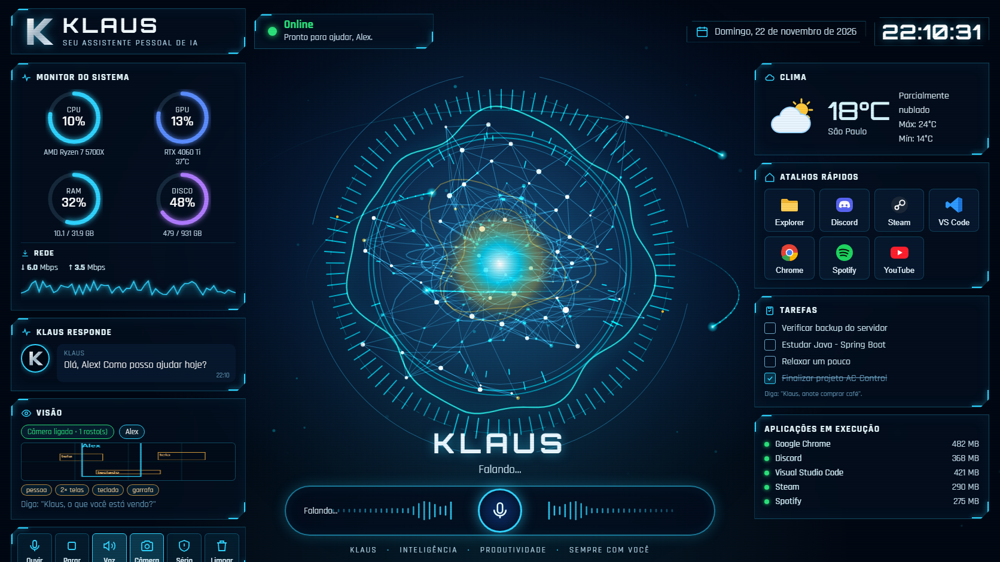
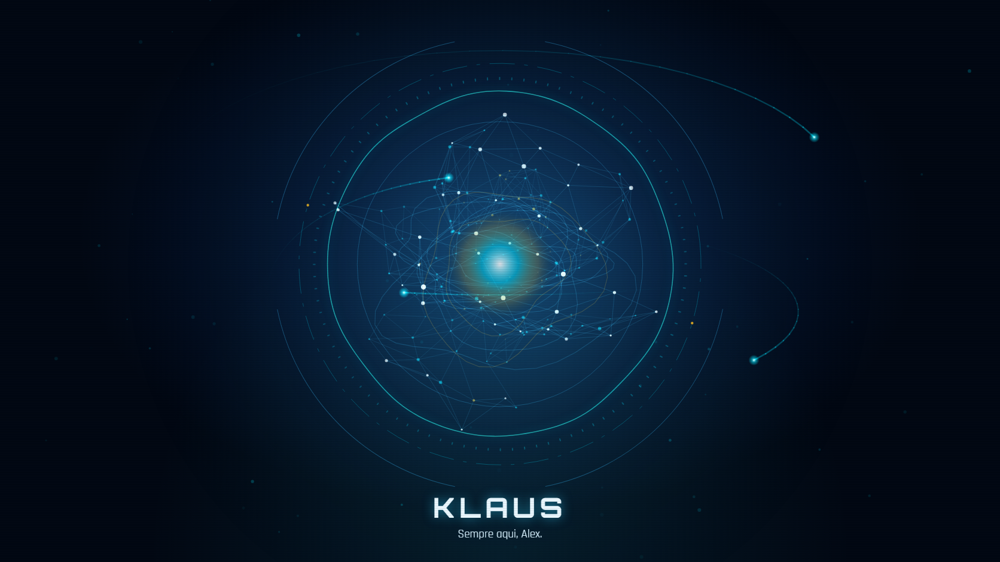
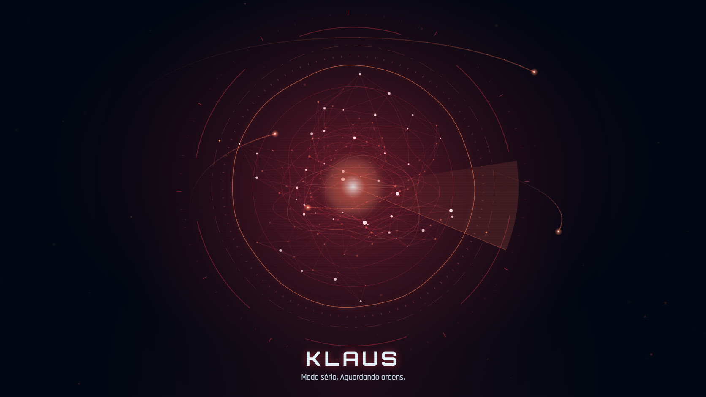
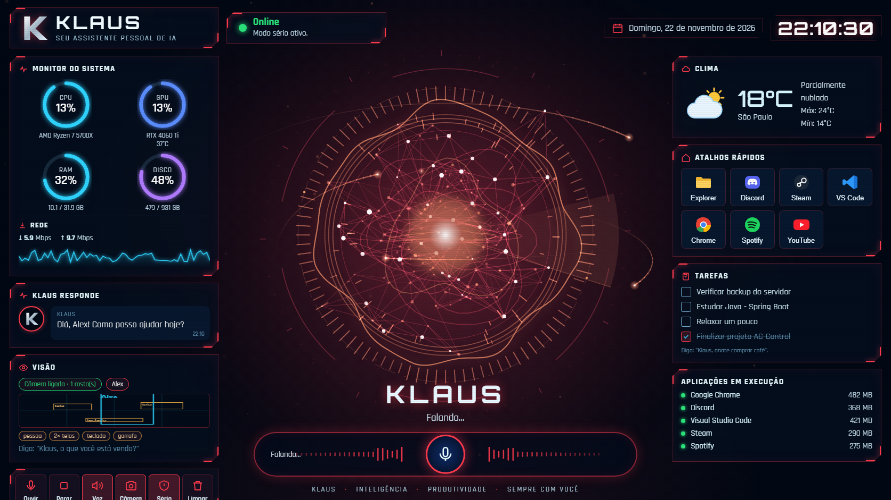

# Klaus

Assistente de voz local para Windows, em português do Brasil. Todo o processamento (reconhecimento de fala, LLM, visão computacional, identificação de falante e síntese de voz) ocorre na máquina do usuário, sem serviços de nuvem e sem chaves de API.



## Sumário

1. [Visão geral](#1-visão-geral)
2. [Arquitetura](#2-arquitetura)
3. [Componentes](#3-componentes)
4. [Ferramentas disponíveis ao LLM](#4-ferramentas-disponíveis-ao-llm)
5. [Modelo de segurança](#5-modelo-de-segurança)
6. [Interface](#6-interface)
7. [Requisitos](#7-requisitos)
8. [Instalação](#8-instalação)
9. [Configuração](#9-configuração)
10. [Execução](#10-execução)
11. [Estrutura do repositório](#11-estrutura-do-repositório)
12. [Limitações conhecidas](#12-limitações-conhecidas)
13. [Dependências e licenças de terceiros](#13-dependências-e-licenças-de-terceiros)
14. [Licença](#14-licença)

## 1. Visão geral

| Capacidade | Implementação |
|---|---|
| Reconhecimento de fala | faster-whisper (CTranslate2), modelo configurável, GPU em float16 ou CPU em int8 |
| Ativação por voz | Palavra de ativação configurável e janela de conversa contínua após cada resposta |
| Identificação de falante | Embeddings de voz com sherpa-onnx; comparação por similaridade de cosseno |
| Visão | Detecção e reconhecimento de rostos (OpenCV YuNet e SFace), detecção de objetos (YOLO11 e YOLOX) e descrição de cena por modelo multimodal local |
| Raciocínio | LLM servido pelo Ollama, com chamada de ferramentas (tool calling) |
| Síntese de voz | Conversor de texto para fonemas em PT-BR, modelo VITS em ONNX Runtime; XTTS-v2 opcional para voz clonada |
| Controle do computador | Leitura de arquivos e execução de comandos com confirmação por voz de administrador, lista de bloqueio e auditoria |
| Interface | Painel em HTML, CSS e JavaScript, comunicação por WebSocket local |

Modelos padrão: `qwen2.5:7b` (raciocínio) e `gemma3:4b` (descrição de imagens), ambos via Ollama.

## 2. Arquitetura

```
Microfone --> ouvido.py (segmentação de fala + faster-whisper)
                  |                        |
                  |                  locutor.py (identifica quem fala)
                  v
            principal.py  <---------- visao.py / objetos.py (webcam: rostos, objetos, cena)
                  |
                  v
            cerebro.py ---> Ollama (LLM com tool calling)
                  |             |
                  |             +--> clima, pesquisa, notícias, futebol
                  |             +--> memoria.py, tarefas.py
                  |             +--> diagnostico.py
                  |             +--> admin.py (arquivos e PowerShell, com confirmação)
                  v
            fala.py --> voz.py (texto -> fonemas -> VITS/ONNX)  [ou voz_clone.py -> tts_server.py (XTTS-v2)]
                  |
                  v
            reprodutor.py (fluxo de saída de áudio contínuo)

principal.py <--> ponte.py <--> interface/klaus_hud.html   (HTTP e WebSocket em 127.0.0.1)
```

Portas locais: `127.0.0.1:8766` (HTTP da interface), `127.0.0.1:8765` (WebSocket), `127.0.0.1:5005` (servidor XTTS-v2, opcional). Da rede externa saem apenas consultas explícitas: cidade (clima), termos de pesquisa e requisições a feeds públicos de notícias e resultados esportivos.

### Fluxo de uma interação

1. O microfone alimenta um detector de fala por energia; o segmento é transcrito pelo Whisper.
2. O trecho de áudio também gera um embedding, comparado com as vozes cadastradas para identificar o falante.
3. O texto é normalizado (correção de grafia de nomes cadastrados) e enviado ao LLM junto com a definição das ferramentas.
4. O LLM responde ou solicita uma ferramenta; o resultado retorna ao LLM, que produz a resposta final.
5. A resposta é convertida em fonemas, sintetizada por sentença e reproduzida em fluxo contínuo, enquanto a interface recebe eventos de estado e de nível de áudio.

## 3. Componentes

| Arquivo | Responsabilidade |
|---|---|
| `assistente/principal.py` | Laço principal: ativação, identificação de falante, modos, comandos de interrupção e confirmações |
| `assistente/cerebro.py` | Cliente do LLM, definição das ferramentas, prompts e rotas com dados reais |
| `assistente/ouvido.py` | Captura de áudio a 16 kHz, segmentação de fala e transcrição |
| `assistente/locutor.py`, `cadastrar.py` | Embeddings de voz e cadastro de falantes |
| `assistente/visao.py` | Detecção e reconhecimento facial, descrição de cena |
| `assistente/objetos.py`, `object_detector.py` | Detecção de objetos (80 classes COCO, nomes em português) |
| `assistente/voz.py`, `fonemas.py`, `dados_fonemas.py` | Conversor PT-BR para fonemas IPA e inferência VITS |
| `assistente/guia.py`, `pronuncias/*.tsv` | Guia de pronúncia de termos estrangeiros e técnicos, com regras de caixa |
| `assistente/voz_clone.py`, `tts_server.py` | Cliente e servidor da voz clonada (XTTS-v2), em ambiente Python separado |
| `assistente/fala.py`, `reprodutor.py` | Síntese em fluxo e saída de áudio sem lacunas |
| `assistente/admin.py` | Acesso ao computador, lista de bloqueio e trilha de auditoria |
| `assistente/diagnostico.py` | Varredura de saúde e segurança do sistema (somente leitura) |
| `assistente/memoria.py`, `tarefas.py`, `nomes.py`, `config.py` | Persistência com gravação atômica e backup, tarefas, normalização de nomes e configuração |
| `assistente/clima.py`, `pesquisa.py`, `noticias.py`, `futebol.py` | Open-Meteo, DuckDuckGo e Wikipédia, Google News (RSS) e API pública da ESPN |
| `assistente/ponte.py`, `app.py` | Servidor HTTP e WebSocket da interface; janela nativa, bandeja do sistema e execução em segundo plano |
| `dicionario/` | Dicionários de termos usados na geração do guia de pronúncia |
| `tools/` | Geradores de ícone, interface e dicionário de tecnologia |

### Reconhecimento de fala

- Taxa de amostragem de 16 kHz, segmentação por energia com tempo de silêncio configurável.
- Dois perfis de transcrição: um rápido (`beam_size=1`, sem filtro VAD) para o fluxo contínuo e outro mais preciso (`beam_size=5`, filtro VAD) para trechos mais longos.
- Com GPU NVIDIA, o modelo roda em float16; sem GPU, em int8 na CPU.

### Identificação de falante e rosto

- Voz: embedding por sherpa-onnx; limiar configurável (`limiar_voz`).
- Rosto: detector YuNet e reconhecedor SFace do OpenCV; limiar de cosseno configurável (`rosto_limiar`).
- Apenas embeddings numéricos são armazenados. Áudio e imagens dos cadastros não são gravados.
- Voz desconhecida aciona o modo sério e uma pergunta de identificação.

### Síntese de voz

- Texto passa pelo guia de pronúncia, é expandido (números e abreviações) e convertido em fonemas IPA.
- A inferência usa um modelo VITS em ONNX Runtime na CPU, com a síntese dividida por sentença e reprodução contínua.
- O modo sério aplica rebaixamento de tom e ritmo mais lento.
- A voz clonada (XTTS-v2) roda como processo separado e transmite PCM de 24 kHz por HTTP local.

## 4. Ferramentas disponíveis ao LLM

| Categoria | Ferramentas |
|---|---|
| Informação | `pesquisar_web`, `wikipedia`, `clima`, `data_hora`, `calcular`, `noticias`, `futebol` |
| Aplicativos | `abrir_programa`, `abrir_site`, `abrir_terminal` |
| Tarefas e memória | `adicionar_tarefa`, `concluir_tarefa`, `listar_tarefas`, `lembrar`, `esquecer` |
| Visão | `ver_ambiente`, `quem_esta_na_camera`, `cadastrar_rosto`, `camera_energia`, `varredura_ambiente` |
| Voz | `cadastrar_voz`, `efeito_de_voz`, `cantar` |
| Sistema | `diagnostico_computador`, `varredura_profunda`, `energia_computador` |
| Arquivos | `procurar_arquivos`, `ler_arquivo`, `listar_pasta` |
| Ações com confirmação | `executar_powershell`, `apagar_arquivo`, `mover_arquivo` |
| Interface | `menus_interface`, `encerrar_klaus` |

`abrir_programa` só executa nomes presentes no dicionário `programas` da configuração.

## 5. Modelo de segurança

- **Processamento local.** Transcrição, LLM, visão, identificação e síntese não dependem de serviços externos.
- **Administradores.** Ações que alteram o computador só são executadas depois que o assistente lê a ação em voz alta e um falante listado em `administradores` confirma por voz. A voz da confirmação é verificada, não apenas o texto.
- **Lista de bloqueio.** `admin.py` recusa, mesmo com confirmação, padrões como exclusão de discos ou pastas vitais, desativação de antivírus e firewall e execução de código baixado da internet.
- **Auditoria.** Cada ação é registrada em `dados/auditoria.log` (JSON por linha) com data, pessoa, indicação de administrador, ação, detalhe e resultado (`NEGADO`, `BLOQUEADO` ou código de saída).
- **Exclusão reversível.** `apagar_arquivo` envia o arquivo para a Lixeira.
- **Memória.** Um filtro impede o armazenamento de senhas, tokens, números de cartão, chaves PIX e códigos de segurança.
- **Persistência.** Configuração e estado são gravados de forma atômica (arquivo temporário seguido de substituição) com cópia `.bak`.
- **Cadastro facial.** O cadastro automático vem desativado (`auto_cadastro_rosto: false`); rostos só entram por comando explícito.
- **Dados do usuário.** `dados/`, `voz/` e `modelos/` constam no `.gitignore`.

O modo sério pode ser configurado com respostas mais ríspidas, inclusive com linguagem forte, e liga automaticamente diante de voz desconhecida. Revise os prompts em `assistente/cerebro.py` antes de usar em ambientes compartilhados.

## 6. Interface

`interface/klaus_hud.html` é um arquivo único (HTML, CSS e JavaScript com canvas). Ele abre em modo limpo, com o núcleo animado reagindo ao estado (ocioso, ouvindo, processando, falando) e ao nível de áudio, e pode exibir os painéis: monitor do sistema, clima, atalhos, tarefas, aplicativos em execução, mensagens e visão.

Protocolo de eventos (JSON pelo WebSocket): `estado`, `usuario`, `klaus`, `nivel`, `telemetria`, `clima`, `apps`, `tarefas`, `visao`, `carga`, `menus`, `info`, `trabalho`.

### Modo normal

| Modo limpo | Com painéis |
|---|---|
|  |  |

### Modo sério

Núcleo vermelho e voz mais grave. Ativado automaticamente por voz desconhecida, varreduras e ações de administrador; desativado quando o falante é reconhecido.

| Modo limpo | Com painéis |
|---|---|
|  |  |

As capturas foram geradas com o modo de demonstração (`klaus_hud.html?demo=1`, com `&menus=1` para os painéis e `&modo=serio` para o modo sério) e dados fictícios.

## 7. Requisitos

- Windows 10 ou 11.
- Python 3.12.
- [Ollama](https://ollama.com) instalado e em execução.
- Microfone. Webcam opcional.
- GPU NVIDIA com CUDA 12.4 recomendada para Whisper, YOLO e LLM; funciona em CPU com desempenho reduzido.

## 8. Instalação

```powershell
git clone https://github.com/andreygiordane/klaus-assistente-voz-local.git
cd klaus-assistente-voz-local

python -m venv .venv
.venv\Scripts\pip install -r requirements.txt
.venv\Scripts\pip install torch==2.6.0 torchvision==0.21.0 --index-url https://download.pytorch.org/whl/cu124

ollama pull qwen2.5:7b
ollama pull gemma3:4b
```

### Modelos locais

Coloque os arquivos em `modelos/` (ignorada pelo Git):

| Arquivo | Uso |
|---|---|
| `yolo11m.pt` | Detecção de objetos (baixado automaticamente pelo Ultralytics se ausente) |
| `yunet.onnx`, `sface.onnx` | Detecção e reconhecimento de rostos (OpenCV Zoo) |
| `speaker.onnx` | Embedding de falante, compatível com sherpa-onnx |
| `yolox.onnx` | Detector alternativo (opcional) |

### Voz de síntese

O motor espera um modelo VITS em ONNX com `tokens.txt` em `voz/klaus/` (`model.onnx` e `tokens.txt`). **O modelo de voz usado pelo autor não é distribuído**, pois foi ajustado com gravações da voz do próprio autor. É possível usar qualquer modelo VITS compatível (por exemplo, vozes PT-BR do projeto Piper), ajustando o conversor de fonemas se o conjunto de símbolos for diferente.

### Voz clonada (opcional)

```powershell
python -m venv .venv_tts
.venv_tts\Scripts\pip install -r requirements-tts.txt
```

Adicione amostras de referência em `voz/clone/` e defina `"voz": "clone"` na configuração.

## 9. Configuração

A primeira execução cria `dados/config.json`. Opções principais (`assistente/config.py`):

| Chave | Padrão | Descrição |
|---|---|---|
| `cidade`, `pais` | `""`, `BR` | Localização para o clima |
| `modelo_llm` | `qwen2.5:7b` | Modelo do Ollama usado no raciocínio |
| `modelo_visao` | `gemma3:4b` | Modelo do Ollama usado na descrição de imagens |
| `whisper` | `small` | `tiny`, `base`, `small`, `medium` ou `large-v3` |
| `microfone` | `null` | Índice do dispositivo no sounddevice |
| `palavra_de_ativacao` | `["klaus"]` | Palavras de ativação |
| `segundos_de_conversa` | `25` | Janela de conversa sem repetir a palavra de ativação |
| `limiar_voz` | `0.55` | Similaridade mínima para reconhecer um falante |
| `rosto_limiar` | `0.5` | Similaridade mínima para reconhecer um rosto |
| `voz` | `vits` | `vits` (CPU, rápida) ou `clone` (XTTS-v2) |
| `objetos_modelo`, `objetos_confianca` | `modelos/yolo11m.pt`, `0.5` | Detector de objetos |
| `camera_continua` | `true` | Mantém a câmera ligada para acompanhamento |
| `auto_cadastro_rosto` | `false` | Cadastro facial automático (mantenha desativado) |
| `administradores` | `[]` | Falantes autorizados a confirmar ações no computador |
| `atalhos`, `programas` | ver código | Botões da interface e programas que podem ser abertos |

Defina `administradores` antes de usar qualquer ação que altere o computador.

## 10. Execução

```powershell
cadastrar_voz.bat                    # cadastro de vozes (armazena apenas embeddings)
iniciar_klaus.bat                    # execução em console
pythonw -m assistente.app            # janela própria e ícone na bandeja
pythonw -m assistente.app --oculto   # somente bandeja (adequado para iniciar com o Windows)
```

Exemplos de comandos falados: "Klaus, como está o clima?", "Klaus, o que você está vendo?", "Klaus, cadastre o rosto da Maria.", "Klaus, anote comprar café.", "Klaus, faça uma varredura no computador."

## 11. Estrutura do repositório

```
assistente/        código-fonte do assistente
  pronuncias/      guias de pronúncia (.tsv)
interface/         interface em HTML e ícone
dicionario/        dicionários de termos
tools/             geradores e utilitários
docs/img/          capturas de tela
requirements.txt   dependências do ambiente principal
requirements-tts.txt  dependências do ambiente de voz clonada
*.bat              atalhos de execução no Windows
```

Não fazem parte do repositório: `dados/` (configuração, memória, cadastros de voz e rosto, logs), `modelos/`, `voz/` e os ambientes virtuais.

## 12. Limitações conhecidas

- Somente Windows: usa APIs e utilitários do sistema (PowerShell, Windows Search, Defender, bandeja).
- O desempenho do LLM, do Whisper e da visão depende de GPU; em CPU a latência é alta.
- A identificação de falante e de rosto é probabilística e sensível a ruído, microfone e iluminação. Não deve ser usada como único fator de autenticação para ações críticas.
- O modelo de voz padrão do autor não é distribuído; é preciso fornecer um modelo VITS compatível.
- O guia de pronúncia e o conversor de fonemas cobrem português do Brasil.

## 13. Dependências e licenças de terceiros

Este projeto usa, entre outros: faster-whisper e CTranslate2, sherpa-onnx, ONNX Runtime, OpenCV, PyTorch, pywebview, coqui-tts (XTTS-v2), Ollama e os modelos Qwen 2.5 e Gemma 3.

Atenção às licenças dos componentes que você instalar:

- **Ultralytics (YOLO11)** é distribuído sob AGPL-3.0, com opção de licença comercial.
- **XTTS-v2** (Coqui) usa a Coqui Public Model License, com restrições de uso comercial.
- **Qwen 2.5 e Gemma 3** têm licenças e termos de uso próprios.
- Os modelos de rosto (YuNet, SFace) vêm do OpenCV Zoo, cada um com sua licença.

Consulte a licença de cada componente antes de redistribuir ou usar comercialmente.

## 14. Licença

O código deste repositório é distribuído sob a licença MIT (arquivo `LICENSE`). Os componentes de terceiros listados acima mantêm suas próprias licenças.
